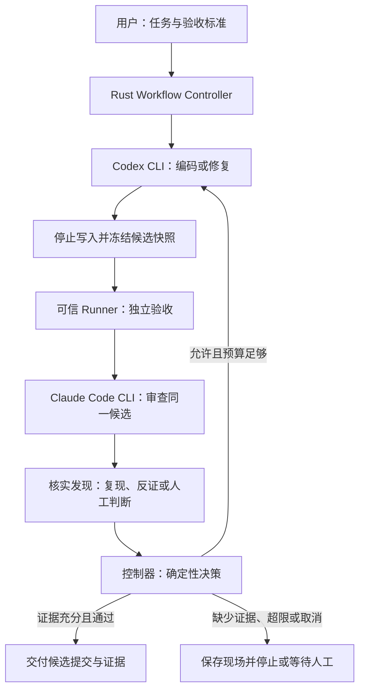

# rust-agent-workflow


一个用 Rust 实现的本地编程任务 workflow 控制器：让 Codex CLI 编码、Claude Code CLI 审查，由控制器执行验收、管理有限修复，并交付可复查的代码与证据。

项目以实现可用于实际任务的系统为主线，每章配套 Rust 新手讲解。当前仅第一章的启动示例已实现，下述系统架构是目标设计。

## 我们要设计的系统

用户提交任务目标、允许修改范围和验收标准。控制器管理执行顺序、工作区、版本、预算和运行记录；两个 Agent 完成各自的技术工作，不能自行宣布任务通过或改写验收标准。



验收不能执行时保留 UNKNOWN；有效证据证明失败时保留 FAIL。运行状态与质量结论分开记录。每次修复生成新候选，旧报告不能自动支持新版本通过。

| 部件 | 职责 |
| --- | --- |
| Controller | 状态转换、决策规则、预算和人工门禁 |
| Executor 与 Agent 适配器 | 受控子进程、会话身份、输出校验、超时与取消 |
| Snapshot 管理 | 独立工作区、冻结协议、候选版本绑定 |
| Verification 与 Finding 核实 | 执行固定验收计划，保存复现、反证及未决项 |
| SQLite 与产物目录 | 保存任务、运行、事件和证据索引，支持崩溃后对账 |

这些是一个本地程序内部的职责划分，不要求拆成多个服务。验收、审查或报告校验失败时进入明确决策，不沿图中的正常路径继续假定成功。

## 控制范围，避免过度设计

首版交付一个 Rust CLI、本地 SQLite 和产物目录，服务本机单用户、单仓库、单任务。用户通过配置和任务文件控制流程。生产可用性限定在经过验收的操作系统、CLI 版本与可信仓库范围内。

Hermes 不属于项目依赖、必做章节或生产就绪条件。用户可以直接使用控制器完成全流程；未来只有在实际任务证明智能协调入口有额外价值时，才另行评估。原始方案中的 Hermes 选型不自动成为本项目决策。

暂不建设 Web 平台、通用插件市场、分布式调度、多租户、动态 Agent 网络、自动合并或发布。18 章是实现与学习的拆解，不是 18 个子系统。新能力需要实际问题、验收场景和明确维护成本；否则留在范围之外。

## 快速开始

安装 Rust 工具链（[官方安装说明](https://www.rust-lang.org/tools/install)），然后运行：

```bash
git clone https://github.com/loveRhythm1990/rust-agent-workflow.git
cd rust-agent-workflow
cargo run -p chapter-01-cargo
```

预期输出：

```text
你好，Rust！
项目：rust-agent-workflow
第 1 章：Cargo 与第一个程序
学习目标：用 Rust 构建可验证的多 Agent 协作工具
```

第一章使用 Rust 2024 edition，无第三方依赖，无需模型账号或 API Key。后续接入真实 CLI 时再核对版本、账号权限与运行参数。

## 学习路线

| 章 | Workflow 主线 | Rust 配套 | 状态 |
| --- | --- | --- | --- |
| 01 | [项目启动与最小任务程序](01-cargo/README.md) | Cargo、变量、函数、格式化输出 | 启动示例已实现，任务入口待补充 |
| 02 | [任务契约与验收标准](02-contracts/README.md) | String、所有权、借用、基础函数 | 规划中 |
| 03 | [任务、运行、结果的数据模型](03-task-model/README.md) | struct、enum、Option、Vec、Serde | 规划中 |
| 04 | [状态机与确定性决策](04-state-machine/README.md) | match、模块、纯函数、单元测试 | 规划中 |
| 05 | [模拟执行器与完整流程](05-simulation/README.md) | Result、错误传播、集合与测试替身 | 规划中 |
| 06 | [受控子进程、超时与取消](06-process/README.md) | Command、错误类型、Tokio 与 async 入门 | 规划中 |
| 07 | [Agent 接口与结构化输出校验](07-adapters/README.md) | trait、组合、Serde、JSON 校验 | 规划中 |
| 08 | [工作区隔离与快照冻结](08-snapshots/README.md) | Path、PathBuf、文件操作、资源清理 | 规划中 |
| 09 | [接入 Codex 编码与 Claude Code 审查](09-dual-cli/README.md) | 配置读取、适配器实现、事件解析 | 规划中 |
| 10 | [独立验证与证据有效性](10-evidence/README.md) | 数据校验、哈希、迭代器 | 规划中 |
| 11 | [审查发现核实与误报处理](11-findings/README.md) | 枚举建模、映射集合、状态更新 | 规划中 |
| 12 | [有限修复、预算与收敛判断](12-convergence/README.md) | Duration、计数器、规则组合 | 规划中 |
| 13 | [SQLite 持久化与事件记录](13-persistence/README.md) | 数据库访问、事务、错误上下文 | 规划中 |
| 14 | [崩溃恢复、幂等与过期结果拒绝](14-recovery/README.md) | 幂等接口、事务条件更新、恢复测试 | 规划中 |
| 15 | [人工决策与交付](15-human-delivery/README.md) | CLI 参数、报告格式、文件组织 | 规划中 |
| 16 | [安全边界与故障注入验收](16-security-faults/README.md) | 集成测试、测试夹具、平台条件编译 | 规划中 |
| 17 | [实际任务试点与效果评估](17-evaluation/README.md) | 统计汇总、Trace 解析、报告生成 | 规划中 |
| 18 | [系统集成与发布验收](18-release/README.md) | 配置、打包与端到端测试 | 规划中 |

## 学习方式

每章提供两份互相链接的文档：

- `README.md`：workflow 的目标、接口、设计选择、运行步骤与验收。
- `RUST.md`：实现中出现的 Rust 语法、类型、用法、常见错误与小练习。

新手可以交替阅读两份文档；熟悉 Rust 的读者可直接沿 workflow 主线前进。采用直接、清晰的实现，只在具体需求出现时引入抽象、泛型和异步。尚未实现章节的 RUST.md 只列计划，不伪装成完成的教程。

章节按 workflow 依赖推进：第 1—5 章建立任务契约、状态机与模拟闭环；第 6—9 章实现受控执行、快照和真实双 CLI 实验；第 10—16 章补齐验证、核实、预算、恢复与安全验收；第 17 章进行实际任务试点；第 18 章完成系统集成、运行手册与发布验收。

第 9 章接入真实 CLI 只用于受控实验。第 16 章首版可靠性门禁验收后，才在第 17 章启用受控实际任务。实际任务试点通过并明确适用范围后，才评估生产就绪；章节完成本身不代表生产可用。

目前根目录使用 Cargo workspace，仅注册已实现章节。后续每章实现时再加入 workspace，避免目录占位被误认为可运行功能。

```bash
cargo check --workspace
cargo fmt --all --check
cargo test --workspace
```

## 首版范围与交付门槛

首版目标：本机单用户、单仓库、单任务，Codex 编码、Claude Code 审查，固定验收命令与有限修复；交付候选提交、审查报告和验证证据，由用户集成。暂不自动合并或发布，不实现多租户、分布式调度和多任务并发。

生产可用需先明确操作系统、信任边界、CLI 支持版本和部署方式，再通过故障验收。状态机、快照绑定、受控执行、取消清理、持久化对账与独立验证属于首版底线；详细成本优化和大型评测可延后。仓库的章节完成状态不等同于生产就绪。

## 最终目标与设计边界

Rust 控制器通过受控 CLI 子进程传递任务、快照和结构化结果；围绕单仓库、单任务的双 CLI 闭环完成可靠执行与交付；并发和额外协调入口需另行证明需求。

- 编码、测试与审查绑定同一候选版本，旧报告不能推进新版本。
- 运行状态、PASS / FAIL / UNKNOWN 与停止原因分别记录。
- Review 发现先核实再修复；空报告和成功退出不能直接证明代码正确。
- 预算覆盖修复和核实；停滞、振荡、超时与取消应可靠停止并保留现场。
- worktree 不是安全沙箱；只读和权限隔离需要实际机制验证。
- 模型漏报、业务歧义和精确用量限制不能凭机制宣称消除，实验应披露剩余限制。

## 参考与公开内容

[原始架构方案 v2](docs/design/Hermes_Codex_Claude_Code_编排架构与证据验收_v2.pdf)（2026-10-09）作为设计背景原样保存。它是待实施方案，包含 Hermes 选型及比首版更广的目标；当前实现范围以本 README 和章节验收计划为准。方案中的需求契约、证据、核实与恢复设计将逐步用代码和实验验证。

公开仓库不提交凭据、真实会话日志或未经检查的模型产物。当前未选择开源许可证；公开可见不等同于授予开源许可。
